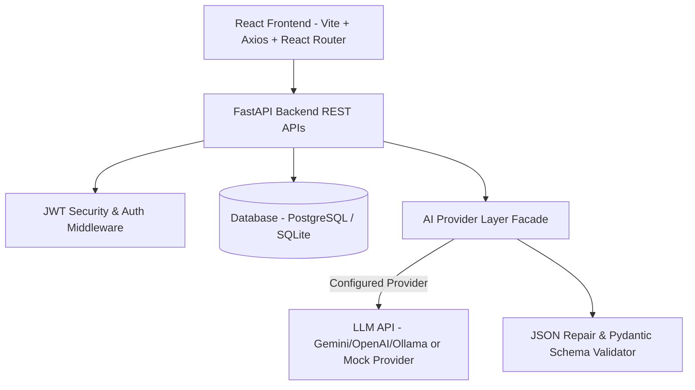

# AI-Powered Software Testing Assistant — System Architecture

## Architecture Overview

## Layered Design Pattern

### 1. Presentation Layer (React Frontend)
- Single Page Application (SPA) built using React 18, React Router v6, and Axios.
- Dynamic responsive UI styling with modern dark theme glassmorphism aesthetics.
- Features: Dashboard Analytics, Requirement AI Generator Workbench, Test Execution Modal, AI Bug Diagnostics Viewer.

### 2. API & Router Layer (FastAPI)
- Clean RESTful endpoints under `/api/v1`.
- Authentication middleware verifying JWT Bearer tokens on protected routes.
- RBAC authorization enforcing user project ownership (`owner_id == current_user.id`).

### 3. Service Layer
- `ProjectService`: Business logic for project isolation and ownership.
- `RequirementService`: Requirement lifecycle management.
- `TestCaseService`: Test case generation, custom ID assignment, search/filter queries, and execution run tracking.
- `BugService`: Defect lifecycle management and auto bug creation on execution failures.

### 4. Pluggable AI Service Subsystem
- `AIService` facade providing high-level methods: `analyze_requirement`, `generate_scenarios`, `generate_test_cases`, `analyze_bug`.
- `BaseAIProvider` abstract base class enabling zero-friction switching between LLM vendors (`OpenAICompatibleProvider`, `MockAIProvider`).
- `json_parser.py`: Robust JSON extractor and repair engine handling markdown code blocks, trailing commas, and Pydantic validation.

### 5. Persistence Layer (SQLAlchemy ORM)
- Relational schema connecting Users, Projects, Requirements, Test Scenarios, Test Cases, Test Executions, Bug Reports, and AI Analyses.
- Seamless SQLite default for zero-config local execution + PostgreSQL support for production deployments.
